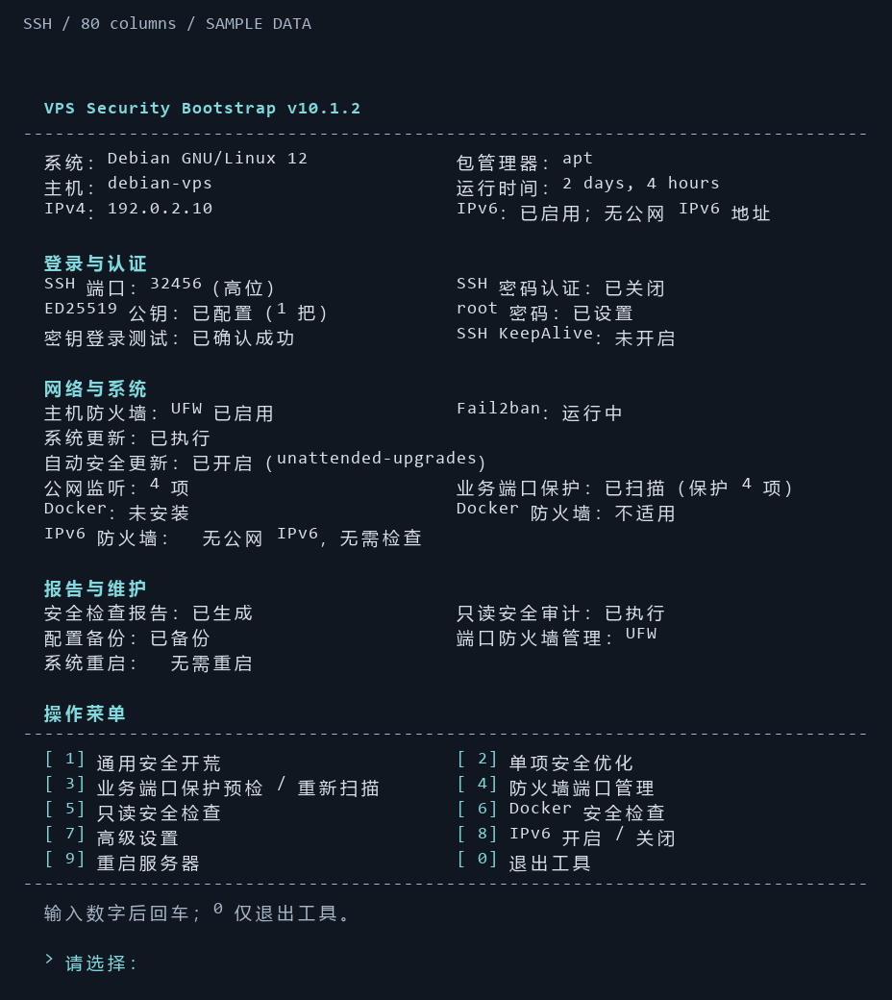

# SSH 终端显示

v10.1.2 仅修改终端 UI，未改变原有模块、菜单编号、参数校验、默认确认、SSH 事务、防火墙、Fail2ban、更新及 IPv6 执行逻辑。

这是 main 上的源码更新，尚未发布新 Release；默认安装器继续下载稳定版 v10.1.1。可在下载当前源码并检查后运行 `sudo bash vps-security.sh` 查看新界面。

## 显示方式

- 主界面保留原有状态字段，按“登录与认证 / 网络与系统 / 报告与维护”分组。
- 主菜单仍为 1–9 和 0；各子菜单的编号及动作保持一致。
- 终端至少 76 列且一行能够完整显示时使用双列，否则自动上下排布。长状态不隐藏、不截断。
- 青色用于标题和导航，绿色/黄色/红色用于显式成功/警告/失败提示。所有提示仍保留文字，颜色不作为唯一信号。
- 状态图标改用 `[OK]`、`[WARN]`、`[FAIL]`、`[INFO]`，减少不同 SSH 客户端 emoji 宽度造成的错位。
- 适配的是终端列宽；完整状态仍可能需要向上滚动。不会强行清除终端滚动历史。

## 可选显示设置

```bash
# 纯文本，适合无颜色终端
sudo env NO_COLOR=1 bash vps-security.sh

# 关闭颜色和菜单清屏，保留连续输出
sudo env VPS_UI_COLOR=never VPS_UI_CLEAR=0 bash vps-security.sh

# 正常 SSH 会话：自动检测终端颜色能力
sudo bash vps-security.sh
```

`VPS_UI_COLOR` 接受 `auto`（默认）、`never`、`always`。`NO_COLOR` 只要存在（包括空值）就禁用颜色；`TERM=dumb` 和 `--audit` 始终使用纯文本，即使指定 `always`。非终端输出在自动模式下不带 ANSI 颜色。`VPS_UI_CLEAR=0` 只关闭清屏，不改变操作流程。

颜色遵循 SSH 客户端当前的 ANSI 配色，因此深色/浅色背景均由客户端主题控制，不强制改终端背景色。中文对齐依赖客户端正常的 UTF-8/CJK 支持。

## 预览

下图由实际 UI 函数输出渲染而来，所有主机、IP 和安全状态均为演示数据，并非真实服务器检测结果。



## 复查

- 对照 v10.1.1，逐个检查现有函数中除显示语句以外的代码；`say` 是统一显示层，`ask` 只更改提示外观。
- 原有 19 项安全回归测试继续执行。
- `python3 tests/ui.py` 检查 ANSI 开关、无终端/审计模式、中文宽度、窄屏和长状态保留、原菜单/状态保留、输入默认值等。Linux CI 另外通过真实 pseudo-terminal 检查自动颜色及 NO_COLOR。
- UI 预览使用 mock 数据，不会运行系统配置操作。生产模块仍以既有测试和验收边界为准。
